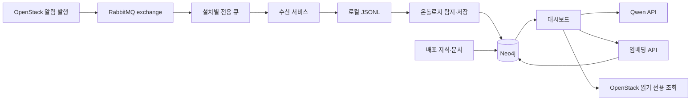

# OpenStack 보안 분석 대시보드

새 Ubuntu PC에서 설치하고 **서비스 주소와 인증정보를 입력하면** 새 OpenStack 알림 수신, 온톨로지 탐지, Neo4j 저장, Qwen 분석을 사용할 수 있는 프로젝트입니다. GitHub 로그인이나 기존 PC의 DB 백업은 필요하지 않습니다.

## 설치

```bash
sudo apt update
sudo apt install -y git
git clone https://github.com/iii494860-create/project.git
cd project
./setup.sh
```

Ubuntu 22.04/24.04와 sudo 권한, 인터넷 연결이 필요합니다. Python 가상환경·패키지, Docker·Compose, Neo4j를 설치합니다. 임베딩 서버도 로컬 자동 설치를 선택할 수 있습니다. 로컬 임베딩은 큰 모델을 내려받으므로 **RAM 16GB 이상, 여유 디스크 30GB 이상을 권장**하며, CPU에서는 첫 색인 생성에 시간이 걸립니다. 기존 임베딩 서버를 쓰면 설치 PC의 자원 부담을 줄일 수 있습니다.

Qwen 대화 모델은 입력한 외부 API 서버를 사용합니다. 현재 분석 하네스는 `/v1/chat/completions`와 `/api/show`의 `thinking.values` ON/OFF 정보를 지원하는 Ollama 계열 서버를 요구합니다. 일반 OpenAI 호환 주소만 제공하는 서버는 그대로 연결되지 않을 수 있으며 설치 중 호환성을 검사합니다. OpenStack 자체와 원격 RabbitMQ는 기존 환경을 연결합니다.

## 설치할 때 입력하는 정보

| 항목 | 입력할 내용 |
|---|---|
| Neo4j | 첫 설치 비밀번호 8자 이상. Enter를 누르면 임의 생성하여 `.env`에 저장 |
| 대시보드 | 이 PC의 접속 IP. 같은 PC에서만 쓰면 `127.0.0.1` |
| Qwen | `http(s)://서버:포트/v1`, 모델 이름, 필요한 경우 API key |
| 임베딩 | 기본값은 로컬 자동 설치. 기존 서버를 쓰면 Ollama API 기본 주소와 4096차원 모델 |
| RabbitMQ | 호스트, 포트, 사용자, 비밀번호, vhost, TLS 여부, **실제 알림 exchange 이름** |
| OpenStack | Keystone v3 URL, 사용자·비밀번호, 프로젝트, 사용자·프로젝트 도메인, 리전. 최대 3개 프로필 저장, 기본 조회 프로필 1개 선택 |

RabbitMQ를 입력하지 않으면 실시간 수집을 활성화하지 않습니다. OpenStack API 조회 인증과 RabbitMQ 알림 수신 인증은 서로 별개입니다. 세 OpenStack 프로필 저장이 세 환경의 알림을 자동 수집한다는 뜻은 아닙니다. 현재 자동 수집은 설정한 RabbitMQ 브로커 한 곳에서 지정한 exchange들을 구독합니다.

주소는 설치 PC에서 도달 가능한 주소여야 합니다. 원격 서비스 주소에 `127.0.0.1`을 넣으면 설치 PC 자신을 가리킵니다.

## 포함된 지식과 자동 검증

`knowledge/`에는 검증 기준이 고정된 온톨로지, 공개 문서, KISA 공지 자료와 SHA-256 목록이 들어 있습니다. 설치마다 외부 사이트의 최신 자료 일부만 가져와 지식이 줄어드는 일을 방지합니다.

| 지식 종류 | 포함 수량 |
|---|---:|
| 온톨로지 지식 노드 | 971 |
| 온톨로지 클래스 | 36 |
| 온톨로지 지식 관계 | 3,714 |
| KISA 공지 | 2,814 |
| KISA CVE | 17,078 |
| 공지 → CVE 관계 | 17,963 |

Cinder 확장, Application Credential 탐지, ATT&CK 기법·전술·완화책, D3FEND, OpenStack 필드·이벤트·조사 명령도 포함합니다. KISA 공지의 검증 상태와 CVE 연결 제한도 보존합니다. **공지가 특정 CVE를 언급했다는 사실은 해당 OpenStack에서 공격이 발생했다는 뜻이 아닙니다.**

공개 원문 문서는 `knowledge/public_docs.tar.gz`에서 `docs/`로 준비합니다. 이것은 설치용 공개 지식 자료이며 운영 DB 백업이 아닙니다. 출처는 [knowledge/manifest.json](knowledge/manifest.json)과 압축 파일의 `docs/sources.csv`에 기록되어 있습니다. 원문 자료에는 각 출처의 이용 조건이 적용됩니다.

검색 대상 803개 노드의 벡터는 설치 중 `qwen3-embedding:8b` 또는 지정한 동일 차원의 모델로 생성합니다. `knowledge_embedding` 색인과 모델·문장 해시·차원을 검사하며, 질문 검색 때도 **같은 임베딩 서버가 계속 실행 중이어야 합니다**. KISA 공지는 별도 공지/CVE 검색 경로를 사용합니다.

온톨로지 식별자·속성·관계, 공지/CVE 식별자·연결, 벡터가 빠졌거나 API 호출이 실패하면 설치 성공으로 표시하지 않습니다. 이전 환경의 실제 로그, 사용자·프로젝트 기록, 경보·사건, 보고서, 사이트별 정상 예외/허용 목록, 비밀번호는 배포하지 않습니다. 새 로그가 들어오면 해당 환경의 기록이 생성됩니다.

## 설치 순서와 실행 구조

1. 시스템 패키지와 Python 의존성을 설치하고 접속 정보를 입력합니다.
2. Docker Neo4j를 시작하고 인증을 확인합니다.
3. Qwen을 실제 호출하고, 설정한 OpenStack의 인증을 확인합니다.
4. 로컬 임베딩을 선택했다면 Ollama와 모델을 설치합니다.
5. 전체 온톨로지·KISA·CVE를 적재하고 임베딩과 색인을 만듭니다.
6. 지식 누락 검사를 통과한 뒤 RabbitMQ 전용 큐를 만들고 서비스와 타이머를 활성화합니다.
7. 대시보드를 시작합니다.



알림은 로컬 파일에 기록·동기화한 후 MQ에 수신 확인합니다. 탐지 타이머가 새 로그를 분석해 Neo4j에 저장합니다. 동일 메시지를 다시 받아도 이벤트와 경보가 중복 생성되지 않으며 미분류 이벤트도 보존합니다. 형식 오류가 있는 알림은 `real_logs/rejected_notifications.jsonl`에 보관합니다.

## 원격 OpenStack/RabbitMQ에서 준비할 것

주소·인증정보를 입력해도 원격 OpenStack의 알림 발행 설정까지 변경되지는 않습니다. **알림이 이미 발행되고 있고 구독 권한이 있어야 새 로그가 들어옵니다.**

- 관련 서비스에 oslo.messaging 알림이 활성화되어 있어야 합니다. 설치 방식에 따라 Kolla 설정 또는 각 서비스 설정을 관리자가 변경합니다.
- RabbitMQ 계정에는 해당 vhost 접근, 기존 알림 exchange 읽기, 설치 전용 큐 생성·바인딩·소비 권한이 필요합니다.
- 관리자는 `rabbitmqctl list_exchanges -p <vhost> name type`, `rabbitmqctl list_bindings -p <vhost>` 등으로 실제 exchange와 routing key를 확인할 수 있습니다. 발행하지 않는 exchange를 입력하면 연결 검사가 실패합니다.
- 기본 구독 키는 `notifications.info/warn/error`, `versioned_notifications.info/warn/error`입니다. 실제 발행 키가 다르면 `.env`의 `RABBIT_ROUTING_KEYS`를 변경합니다.
- **기존 운영 큐를 공유하면 메시지를 나눠 소비합니다.** 설치 프로그램은 무작위 이름의 전용 큐를 생성합니다. 기존 운영 환경의 수집을 방해하지 않도록 이 방식을 사용하세요.
- 서버·VM·방화벽에서 RabbitMQ와 API 포트로 통신할 수 있어야 합니다. 사설 인증서는 신뢰 저장소에 등록하거나 RabbitMQ의 `RABBIT_CA_FILE`을 지정합니다.

설치 과정의 바인딩 확인은 구독 가능한지 검사합니다. 실제 발행 여부는 OpenStack에서 테스트 작업 후 대시보드의 새 로그를 확인해야 합니다. 배포판·서비스에 따른 알림 설정은 포함된 공식 문서 `docs/logs/`를 참고하세요.

## 실행·상태 확인

```bash
./run_dashboard.sh
# 로그 수집과 탐지는 부팅 시 자동 실행됩니다.
systemctl status cto-openstack-consumer cto-live-detection.timer cto-binding-check.timer
journalctl -u cto-openstack-consumer -u cto-live-detection --since '10 minutes ago'
```

접속 주소는 `http://<입력한 대시보드 IP>:8501`입니다. 대시보드는 실행 터미널을 종료하면 멈추므로 다시 `./run_dashboard.sh`를 실행하세요. Neo4j·로컬 임베딩과 수집 서비스는 별도로 실행됩니다. 서비스 이름이 다른 설치에서 사용 중이면 덮어쓰지 않고 중단합니다.

```bash
# 지식만 다시 확인 (암호를 shell 명령으로 실행하지 않는 설정 로더)
ROOT="$PWD"
. ./env.sh
.venv/bin/python knowledge_assets.py verify
```

설정 파일은 `.env`, `clouds.yaml`, `.qwen_api_key`에 저장되며 Git에서 제외합니다. 값을 수정했다면 대시보드를 다시 실행하고, 수집 설정을 수정했을 때는 `sudo systemctl restart cto-openstack-consumer`를 실행하세요. 이미 초기화한 Neo4j의 비밀번호는 `.env`만 바꿔도 변경되지 않습니다.

## 지식 갱신과 운영 주의

포함 자료의 기준일은 2026-11-17입니다. 최신 공지 수집 도구도 포함합니다. 자동 설치는 검증된 배포 지식으로 시작하며, 외부 공지 갱신은 관리자가 필요할 때 실행합니다.

```bash
ROOT="$PWD"
. ./env.sh
.venv/bin/python kisa_rss_collector.py
.venv/bin/python cto_kisa_detail.py --limit 30
.venv/bin/python cto_kisa_ontology.py --sync
```

ATT&CK·OpenStack 문서를 갱신해 온톨로지를 다시 만드는 도구도 유지합니다. 배포된 `knowledge/`를 갱신할 때는 노드·관계 변화와 검색 색인을 함께 검증해야 합니다. 현재 검증기는 포함된 지식이 임의로 사라진 경우 실패합니다.

운영 전 주의사항과 검증 범위는 [INSTALL_NOTES.md](INSTALL_NOTES.md)를 확인하세요.
