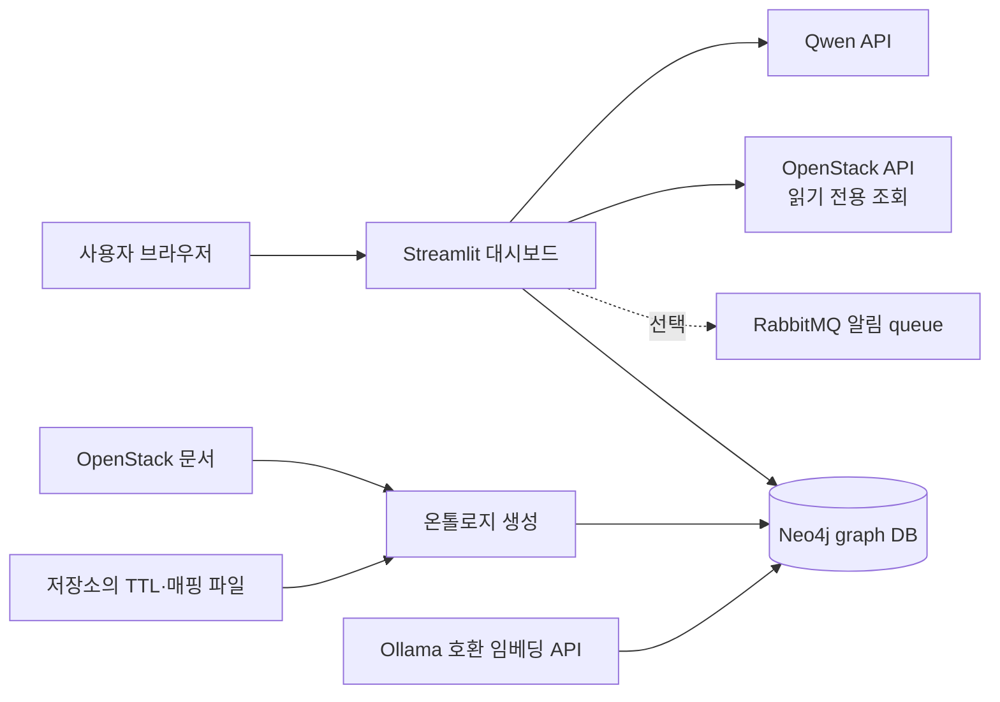

# OpenStack 위협 분석 대시보드 설치 가이드

이 저장소는 대시보드 코드와 온톨로지 원본·생성 도구를 제공합니다. 저장소는 공개이므로 GitHub 로그인 없이 clone할 수 있습니다. 새 PC 설치는 **운영 데이터 복사 방식이 아니라 온톨로지와 벡터 데이터를 새로 만드는 방식**입니다.

설치 전 확인 사항은 [INSTALL_NOTES.md](INSTALL_NOTES.md)를 참고하세요.

## 구성



- **대시보드**: Streamlit 앱과 Qwen 질의·분석 코드
- **지식 그래프**: Docker Neo4j에 OpenStack·보안 온톨로지를 저장
- **임베딩**: 임베딩 API가 만든 4096차원 벡터를 Neo4j 벡터 색인에 저장
- **OpenStack 조회**: 설치 때 고른 cloud 프로필 하나를 사용하며 읽기 전용 CLI 허용 목록으로 조회
- **RabbitMQ**: 설정한 경우 알림 queue 상태를 확인. OpenStack 알림 발행이나 queue 생성은 별도 서버 설정

## 설치 전 준비

- Ubuntu 22.04 이상, Git, 인터넷 연결, 시스템 패키지를 설치할 `sudo` 권한
- Qwen API 주소와 사용할 모델. API key가 필요한 서버라면 해당 key
- Ollama 호환 임베딩 API 주소와 모델. `/api/embed`를 제공하고 모델이 **4096차원** 벡터를 반환해야 함
- OpenStack을 조회할 경우 Keystone v3 주소, 사용자명·비밀번호, 프로젝트 정보 및 필요한 조회 권한
- RabbitMQ 알림 queue를 조회할 경우 브로커 주소와 계정. 이 항목은 선택이며 포트 기본값은 5672

Qwen API와 임베딩 API는 설치 PC에서 접속 가능해야 합니다. 이 저장소는 두 API 서버나 OpenStack 환경 자체를 설치하지 않습니다.

## 새 PC에 설치

먼저 Git을 준비하고 공개 저장소를 clone합니다.

```bash
sudo apt update
sudo apt install -y git
git clone https://github.com/iii494860-create/project.git
cd project
./setup.sh
```

`setup.sh`가 Ubuntu 패키지 저장소를 설정하고 Python 가상환경, Python 패키지, Docker Engine/Compose가 없으면 설치합니다. Docker 서비스를 시작한 다음 설정 질문을 표시합니다. 시스템 패키지와 Docker 설치에는 `sudo` 권한이 필요합니다.

### 설치 중 입력할 값

1. **Neo4j 비밀번호**: 첫 설치 때 입력합니다. 8자 이상이어야 하며 `$`, 백틱, 백슬래시는 사용할 수 없습니다. 비워 두면 임의의 비밀번호를 생성해 `.env`에 저장합니다. 초기 사용자는 Neo4j Docker의 제한에 따라 `neo4j`로 고정됩니다.
2. **대시보드 접속 IPv4**: 같은 PC에서만 쓸 경우 기본값 `127.0.0.1`. 다른 PC에서 접속하려면 대시보드 PC의 LAN 주소
3. **Qwen API**: OpenAI 호환 기본 URL(`/v1` 포함), 모델명, 필요한 경우 API key
4. **임베딩 API**: 기본 URL(`/api/embed`는 제외), 모델명. 기본값은 `http://127.0.0.1:11434`, `qwen3-embedding:8b`
5. **RabbitMQ**: 알림 queue를 쓸 경우 host, 사용자·비밀번호, vhost, queue. 사용하지 않으면 host 입력을 비움
6. **OpenStack**: 최대 세 Keystone v3 프로필의 주소, 사용자명·비밀번호, 프로젝트명, 선택적 프로젝트 ID, 리전. 현재 대화형 설정은 비밀번호 인증과 `Default` 도메인을 사용합니다. 사용하지 않는 프로필은 주소를 비움
7. 등록한 OpenStack 프로필 중 기본 프로필 하나 선택

설치 중 입력한 주소는 `.env`와 `clouds.yaml`에 저장되어 대시보드가 해당 서비스에 연결할 때 사용합니다. 주소만으로 OpenStack이나 인증이 필요한 API에 로그인할 수는 없으므로 계정 인증정보도 입력해야 합니다.

Neo4j 비밀번호 입력은 저장소의 **첫 설치 시에만** 표시됩니다. 기존 `.env`와 Neo4j 데이터 볼륨이 있는 환경에서 비밀번호를 바꾸려면 `.env` 값만 고치면 안 됩니다. Neo4j는 초기화된 데이터 볼륨의 인증 정보를 유지하므로, 기존 DB 비밀번호 변경 절차를 사용해야 합니다.

### 기존 환경의 데이터까지 이식

저장소 루트에 `migration_bundle.tar.gz`가 있으면 `./setup.sh`가 새 Neo4j에 백업을 복원합니다. 로그(`ObservedEvent`), 경보·사건, 온톨로지, 저장된 임베딩을 가져오며, 임베딩 캐시로 색인을 확인하므로 복원 과정에서 임베딩 API를 다시 호출하지 않습니다. 대상 Neo4j에 노드가 이미 있으면 덮어쓰지 않고 중단합니다.

현재 제공된 백업은 **2026-11-16 12:09 UTC 시점**의 스냅샷입니다. 이 백업에는 실제 로그와 사용자·자원 식별자가 포함될 수 있어 공개 저장소에 올리지 않으며 Git에서도 제외됩니다. 새 PC에서는 공개 저장소를 clone한 뒤 이 파일을 별도의 신뢰 가능한 경로로 프로젝트 루트에 복사하고 `./setup.sh`를 실행해야 합니다. 백업 시각 이후에 발생한 로그는 포함되지 않으며, 실시간 로그 수신 기능도 별도로 구성해야 합니다.

`migration_bundle.tar.gz`가 없는 clone에서는 기존 로그 데이터를 가져오지 않고, 외부 문서와 소스 자료로 온톨로지만 새로 생성합니다.

**자동 설정되는 범위**는 대시보드가 바인딩할 IP와 애플리케이션의 서비스 주소입니다. OS 네트워크 인터페이스, DNS, 라우팅, 방화벽 규칙, 원격 OpenStack/RabbitMQ 알림 설정은 자동으로 바꾸지 않습니다. 해당 서비스까지의 네트워크 경로와 방화벽은 관리자 쪽에서 준비해야 합니다.

### 설치 단계에서 자동 처리하는 작업

1. Docker Neo4j를 시작하고 연결을 확인
2. 외부 문서를 내려받아 저장소의 `schema.ttl`, `openstack_mapping.ttl`, 매핑 자료와 함께 온톨로지 생성
3. 온톨로지를 Neo4j에 적재
4. 임베딩 API를 호출해 벡터와 `knowledge_embedding` 색인 생성
5. 대시보드 실행

문서 다운로드, Docker 이미지 다운로드, Qwen·임베딩·OpenStack API 접속을 위해 네트워크가 필요합니다. 설치가 끝나면 터미널에서 대시보드가 실행 중입니다. 종료는 `Ctrl+C`입니다.

## 접속과 재실행

- 같은 PC에서: `http://127.0.0.1:8501`
- 다른 PC에서: `http://<대시보드-PC의-LAN-IP>:8501`
- 원격 접속을 위해 대시보드 PC 방화벽에서 TCP 8501을 허용해야 합니다.
- 나중에 대시보드만 다시 시작할 때는 프로젝트 폴더에서 `./run_dashboard.sh`를 실행합니다. 설치를 반복할 때는 설정과 온톨로지 적재도 다시 수행될 수 있습니다.

Neo4j Web UI는 `http://127.0.0.1:7474`, Bolt 연결은 `bolt://127.0.0.1:7687`입니다. Neo4j 포트는 localhost에만 열리고 데이터는 Docker volume `neo4j_data`에 저장됩니다. 대시보드용 8501 포트와 Neo4j의 7474·7687 포트가 이미 사용 중이면 설치 전에 충돌을 해결하세요.

## 설정·데이터 위치

- `.env`: 대시보드 주소, API 주소와 모델, Neo4j 설정, 선택된 OpenStack 정보, 선택적 RabbitMQ 설정
- `clouds.yaml`: OpenStack 프로필의 인증정보
- `.qwen_api_key`: 입력한 Qwen API key
- `.venv/`: Python 패키지
- `docs/`, `out/ontology_all.ttl`: 내려받은 문서와 생성된 온톨로지
- `embeddings_cache.jsonl`: 재실행 시 같은 텍스트의 임베딩을 재사용하는 캐시
- Docker volume `neo4j_data`: 온톨로지와 벡터 색인을 포함한 Neo4j 데이터

설정 파일과 생성 데이터는 `.gitignore`로 Git에서 제외됩니다. 공개 저장소에는 원본 스키마·매핑·프로그램만 올라갑니다. 따라서 새 PC 설치는 현재 PC의 관측 이벤트, 경보, 로그, Neo4j 데이터를 복사하지 않습니다.

OpenStack 주소를 변경하려면 `.env`의 `OPENSTACK_AUTH_URL`을 바꾸고 대시보드를 다시 시작합니다. 인증정보와 프로필을 변경할 때는 로컬 `clouds.yaml`을 수정합니다. 설정을 새로 입력하려면 `./.venv/bin/python configure.py`를 실행합니다.

## 문제 해결

- **sudo 권한 오류**: 시스템 관리자 계정으로 `./setup.sh`를 실행해야 합니다.
- **Neo4j 포트 사용 중**: 7474 또는 7687을 점유한 기존 Neo4j를 확인하세요. 기존 서비스를 사용 중인 PC에 무심코 설치하면 충돌할 수 있습니다.
- **임베딩 연결/차원 오류**: URL이 기본 주소인지, `/api/embed`가 제공되는지, 모델이 준비됐고 4096차원인지 확인하세요.
- **OpenStack 401/403**: Keystone URL, 계정·프로젝트 정보와 조회 권한을 확인하세요.
- **RabbitMQ 연결 실패**: 주소·계정·vhost·queue가 맞는지 확인하고, RabbitMQ 관리자가 queue 및 OpenStack 알림 전달을 설정했는지 확인하세요.
- **문서 다운로드 실패**: 외부 네트워크와 DNS 접근을 확인한 뒤 `./setup_knowledge.sh`를 다시 실행하세요.

## 저장소 주요 파일

- `dashboard_app.py`, `cto_*.py`, `qwen_*.py`: 대시보드·분석·질의 코드
- `schema.ttl`, `openstack_mapping.ttl`, `d3fend_mitigation_map.csv`: 온톨로지 원본과 매핑
- `download_docs.sh`, `build_ontology.py`, `load_neo4j.py`, `embed_knowledge.py`: 다운로드·생성·적재·임베딩
- `configure.py`, `setup.sh`, `start_services.sh`, `run_dashboard.sh`: 설정과 설치·실행
